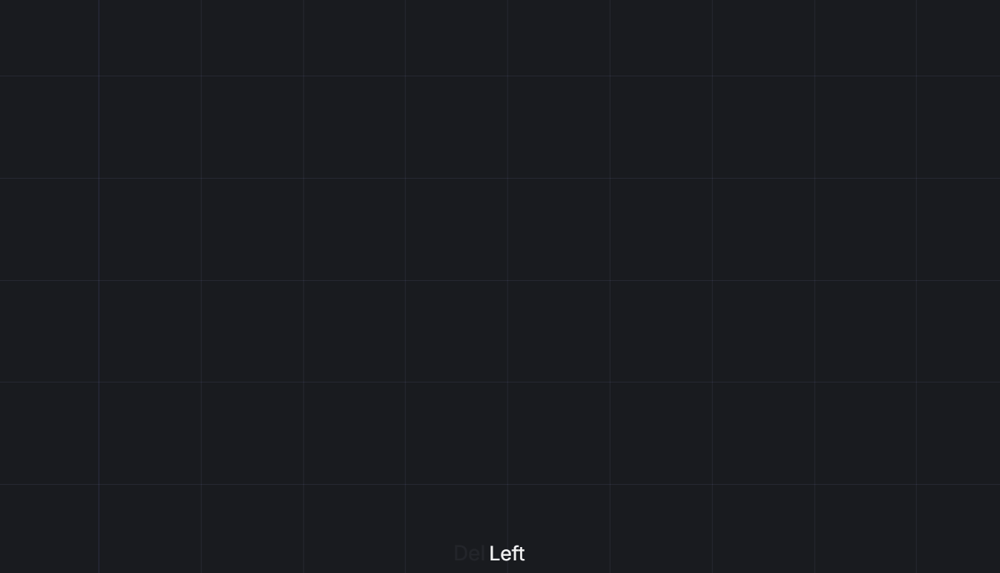
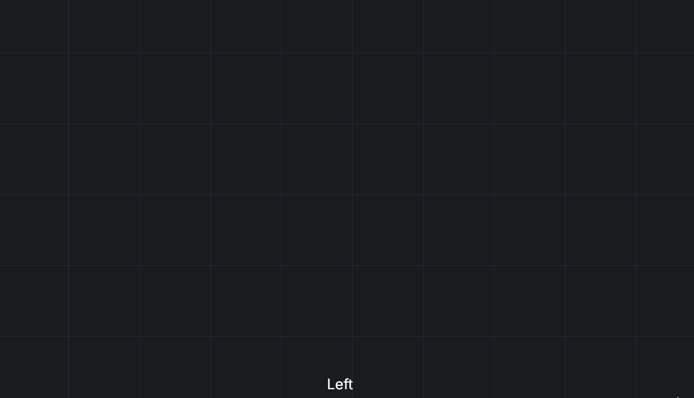
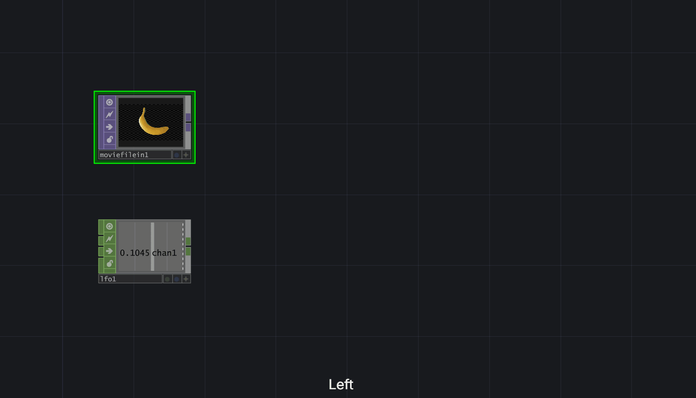

# TD Quick Search

[English](README.md) | [繁體中文](README.zh-TW.md) | **日本語**

TouchDesigner 用のコンパクトなオペレーター検索ポップアップです。ショートカットを押して、数文字入力し、Enter を押すだけです。

同じ名前のオペレーターは 1 行にまとめて表示されます。まず名前を探し、次にファミリーを選びます。そのオペレーターが存在するファミリーのタグがハイライトされ、ハイライトされたファミリーの間だけを切り替えられます。


- 初期状態では、1 行の検索欄とファミリータグだけを表示
- 略語検索:`mfi` や `m f i` で Movie File In が見つかる
- 接続モードでは、新しいオペレーターを現在のオペレーターにつなぎ、その横に配置する
- 作成したオペレーターは Ctrl+Z(macOS では Cmd+Z)で元に戻せる
- オペレーターの一覧は TouchDesigner 自体から読み込むので、新しいビルドで追加されたオペレーターもツールを更新せずに表示される
- 標準の OP Create ダイアログには手を加えない。Tab とダブルクリックはこれまで通り使える
- `.tox` ひとつだけ、依存関係なし

## インストール

[`quick_search.tox`](quick_search.tox) をダウンロードし、プロジェクトのルート(`/`)にドロップしてください。

コンポーネントはプロジェクトに保存されるので、使いたいプロジェクトごとに追加してください。

**動作環境:** Windows または macOS。TouchDesigner 2025.30000 系のビルドでのみテストしています。

## 使い方

ネットワークエディター上にマウスを置いた状態で:

| キー | 動作 |
| --- | --- |
| Ctrl+Tab(macOS では Option+Tab) | ポップアップを開く / 閉じる |
| Shift+Tab | 接続モードで開く |
| 文字を入力 | 検索(2 文字以上) |
| ↑ / ↓ | オペレーターを選ぶ |
| Tab / Shift+Tab、または → / ← | ハイライトされたファミリーを切り替える |
| Enter | オペレーターを作成 |
| Esc、または他の場所をクリック | 閉じる |

最初に選ばれるファミリーは、選択中のオペレーターのファミリーです。選択中のものがなければ、最後に配置したオペレーターのファミリーが選ばれます。

### 検索

名前の先頭に一致するものが最初に並び、次に各単語の先頭、略語、最後に入力した文字を含むものの順になります。接続モードでは、さらに接続元のファミリーが優先されます(下記参照)。



### 配置

Enter を押すか、検索結果の行、またはハイライトされたファミリータグをクリックします。オペレーターはポップアップを開いたときのマウス位置に作成されます。



### 接続モード

Shift+Tab は、現在のオペレーター(緑の枠が付いているもの)を接続元として使います:

- 接続元の最初の出力を、新しいオペレーターの最初の入力につなぐ
- 新しいオペレーターは接続元の右に配置される。その位置が埋まっていれば下にずらす
- ファミリーは最初から接続元と同じものが選ばれる
- 接続元のファミリーにあるオペレーターが先に並ぶ。たとえば LFO CHOP から `tr` と入力すると、Trim、Trail、Trigger、Transform が Trig POP より前に来る。名前の一致度が優先されることは変わらず、他のファミリーも除外されずに後ろに並ぶ
- 新しいオペレーターが現在のオペレーターになるので、もう一度 Shift+Tab を押せばマウスを使わずにそのまま接続を続けられる

別のファミリーのオペレーターを選んだ場合は、接続元の横に配置されるだけで、接続はされません。



## 設定

コンポーネントの **Quick Search** パラメーターページで変更できます:

| パラメーター | 初期値 | |
| --- | --- | --- |
| Shortcut | 空欄 | ポップアップを開く。空欄の場合、デフォルトで `ctrl.tab`(macOS では `alt.tab`)が使用される |
| Connect Shortcut | `shift.tab` | 接続モードでポップアップを開く |

## 制限事項

- Windows:表示スケール 100% でのみテストしています。通常モードの配置位置はマウスのスクリーン座標から計算しており、ウィンドウ枠を 8 ピクセルと仮定しています。
- macOS:1 台の Mac(内蔵 Retina ディスプレイと外部ディスプレイ 1 台)でのみテストしています。
- 一覧にはすべてのオペレーターが含まれ、ライセンスやプラットフォームによる絞り込みはしていません。
- 接続モードは同じファミリー内で、最初の出力を最初の入力につなぐだけです。変換用のオペレーターを自動で挟むことはしません。

## 方針

このツールはコンパクトなままにしておく方針です。機能を絞っており、想定していた機能はすでに揃っています。バグは修正しますが、新機能の追加については現在考えていません。機能を追加したい場合は、MIT ライセンスのもとで自由にフォークしていただけます。

## ソースからビルドする

`quick_search.tox` は `build_quick_search.py` と `QuickSearchExt.py` から生成されています。再ビルドするには、Textport(Alt+T、または Dialogs > Textport)で次の行を実行してください。`<path>` はこのフォルダーのパスに置き換えます:

```python
src = r'<path>'; exec(open(src + '/build_quick_search.py', encoding='utf-8').read())
```

`/quick_search` が作り直されます。ショートカットの設定は引き継がれます。コンポーネントを右クリックして *Save Component .tox* を選ぶと保存できます。

`MIN_CHARS`、`MAX_ROWS`、接続モードの間隔(`GAP_X`、`GAP_Y`)は `QuickSearchExt.py` の先頭にある定数です。

## ライセンス

[MIT](LICENSE)
