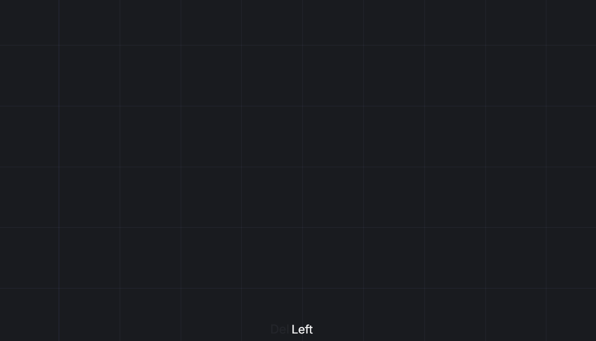
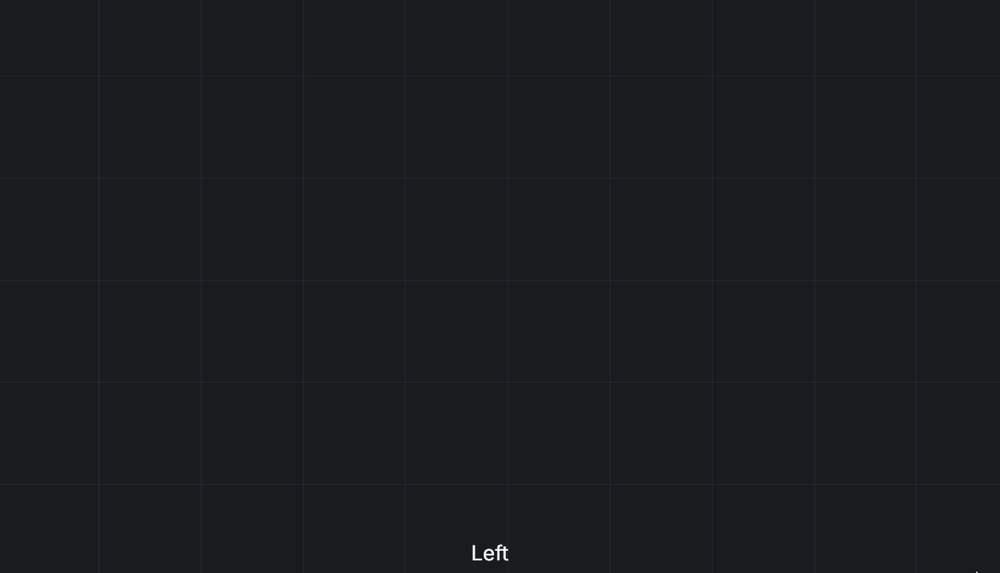
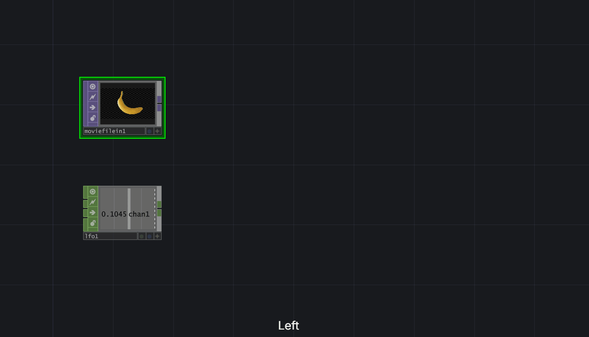

# TD Quick Search

**English** | [繁體中文](README.zh-TW.md) | [日本語](README.ja.md)

A small operator search popup for TouchDesigner. Press a shortcut, type a few
letters, press Enter.

Operators that share a name are one row. Find the name first, then pick the
family: the families that have it light up, and you step through only those.


- Starts as a single search line with a row of family tags
- Abbreviations: `mfi` or `m f i` finds Movie File In
- Connect mode wires the new operator to the current one and places it beside it
- New operators can be undone with Ctrl+Z (Cmd+Z on macOS)
- The operator list is read from TouchDesigner itself, so operators added in
  newer builds show up without an update
- Leaves the built-in OP Create dialog alone: Tab and double-click work as before
- One `.tox`, no dependencies

## Install

Download [`quick_search.tox`](quick_search.tox) and drop it into the root (`/`)
of your project.

The component is saved with the project, so add it to each project you want it in.

**Requirements:** Windows or macOS. Tested on TouchDesigner 2025.30000 builds only.

## Usage

With the mouse over a network editor:

| Key | Action |
| --- | --- |
| Ctrl+Tab (Option+Tab on macOS) | Open or close the popup |
| Shift+Tab | Open in connect mode |
| Type | Search (2 or more characters) |
| ↑ / ↓ | Pick an operator |
| Tab / Shift+Tab, or → / ← | Step through the lit families |
| Enter | Create the operator |
| Esc, or a click elsewhere | Close |

The family selected first is the family of the selected operator, or the family
you placed last.

### Search

Matches at the start of the name come first, then the start of any word, then
abbreviations, then anything containing what you typed. Connect mode also
puts the source's family first (see below).



### Placing

Press Enter, or click a row or a lit family tag. The operator is created where
the mouse was when the popup opened.



### Connect mode

Shift+Tab uses the current operator (the one with the green outline) as the source:

- its first output is wired to the new operator's first input
- the new operator is placed to its right, or below that if the spot is taken
- the family defaults to the source's family
- results that come in the source's family are listed first: from an LFO CHOP,
  `tr` puts Trim, Trail, Trigger and Transform ahead of Trig POP. How well a
  name matches still comes first, and other families follow instead of being
  filtered out
- the new operator becomes the current one, so pressing Shift+Tab again
  continues the chain without reaching for the mouse

Picking an operator from another family places it beside the source without a wire.



## Settings

On the component's **Quick Search** parameter page:

| Parameter | Default | |
| --- | --- | --- |
| Shortcut | empty | Opens the popup. Empty means `ctrl.tab`, or `alt.tab` on macOS |
| Connect Shortcut | `shift.tab` | Opens the popup in connect mode |

## Limitations

- Windows: tested at 100% display scaling only. In normal mode the position
  comes from the mouse's screen coordinates and assumes an 8 pixel window frame.
- macOS: tested on one Mac, with its Retina display and one external display.
- The list has every operator; it is not filtered by licence or platform.
- Connect mode wires first output to first input within one family. It does not
  insert converter operators.

## Scope

This tool is meant to stay small. It does one thing, and it is considered
feature complete: bugs get fixed, new features are unlikely. If you want more,
it is MIT licensed, so fork it and make it yours.

## Building from source

`quick_search.tox` is generated from `build_quick_search.py` and
`QuickSearchExt.py`. To rebuild it, run this in the Textport (Alt+T, or Dialogs > Textport), with
`<path>` set to this folder:

```python
src = r'<path>'; exec(open(src + '/build_quick_search.py', encoding='utf-8').read())
```

That recreates `/quick_search`, keeping your shortcut settings. Right-click the
component and choose *Save Component .tox* to save it.

`MIN_CHARS`, `MAX_ROWS` and the connect mode spacing (`GAP_X`, `GAP_Y`) are
constants at the top of `QuickSearchExt.py`.

## License

[MIT](LICENSE)
