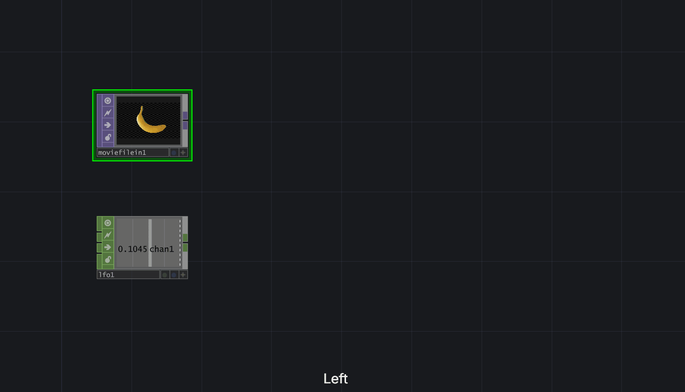

# TD Quick Search

[English](README.md) | **繁體中文**

TouchDesigner 的小型節點搜尋列。按快捷鍵、打幾個字、按 Enter。

同名的節點只佔一列。先找名字,再選家族:有這個節點的家族標籤會亮起,
切換時只會在亮起的家族之間移動。


- 一開始只有一行搜尋列和一排家族標籤
- 支援縮寫:`mfi` 或 `m f i` 都能找到 Movie File In
- 接線模式會把新節點接到目前節點,並排在它旁邊
- 新建的節點可以用 Ctrl+Z 復原
- 節點清單直接讀自 TouchDesigner,新版本新增的節點不需要更新就會出現
- 不更動內建的 OP Create 選單,Tab 和雙擊照常使用
- 只有一個 `.tox`,沒有相依套件

## 安裝

下載 [`quick_search.tox`](quick_search.tox),拖進專案的根層(`/`)。

元件是存在專案檔裡的,所以每個要用的專案都要放一次。

**需求:** Windows。只在 TouchDesigner 2025.30000 系列測試過。

## 使用方式

滑鼠停在 network editor 上:

| 按鍵 | 動作 |
| --- | --- |
| Ctrl+Tab | 開啟或關閉搜尋列 |
| Shift+Tab | 以接線模式開啟 |
| 打字 | 搜尋(2 個字以上) |
| ↑ / ↓ | 選節點 |
| Tab / Shift+Tab,或 → / ← | 在亮起的家族之間切換 |
| Enter | 建立節點 |
| Esc,或點擊其他地方 | 關閉 |

一開始選中的家族,是目前選取節點的家族;沒有選取節點時,是上一次放下的家族。

### 搜尋

名稱開頭符合的排最前面,其次是任一單字的開頭、縮寫,最後是名稱中包含輸入文字的。


### 放下節點

按 Enter,或點結果列、點亮起的家族標籤。節點會建立在開啟搜尋列當下的滑鼠位置。


### 接線模式

Shift+Tab 會以目前節點(綠色外框的那個)作為來源:

- 它的第一個輸出會接到新節點的第一個輸入
- 新節點排在它的右邊;那個位置已經有節點時往下排
- 預設家族與來源節點相同
- 新節點會成為目前節點,所以再按一次 Shift+Tab 就能接著往下接,不用去拿滑鼠

選了其他家族的節點時,只會排在來源旁邊,不接線。



## 設定

在元件的 **Quick Search** 參數頁:

| 參數 | 預設 | |
| --- | --- | --- |
| Shortcut | `ctrl.tab` | 開啟搜尋列 |
| Connect Shortcut | `shift.tab` | 以接線模式開啟 |

## 已知限制

- 僅支援 Windows。滑鼠位置和 Shift 鍵的狀態是透過 Windows API 讀取的,
  所以目前的版本無法在 macOS 上執行。
- 只在 100% 顯示縮放下測試過。
- 一般模式的節點位置由滑鼠的螢幕座標換算,並假設視窗邊框為 8 像素。
- 清單包含所有節點,不會依授權或作業系統過濾。
- 接線模式只在同一個家族內,把第一個輸出接到第一個輸入,不會自動插入轉換節點。

## 專案範圍

這個工具打算維持小巧。它只做一件事,而且功能已經算是完成:
有 bug 會修,但不太會再加新功能。想要更多功能的話,它是 MIT 授權,歡迎 fork 去改。

## 從原始碼建置

`quick_search.tox` 是由 `build_quick_search.py` 和 `QuickSearchExt.py` 產生的。
要重建的話,在 Textport(Alt+T)執行下面這行,把 `<path>` 換成這個資料夾的路徑:

```python
src = r'<path>'; exec(open(src + '/build_quick_search.py', encoding='utf-8').read())
```

這會重建 `/quick_search`,並保留你的快捷鍵設定。在元件上按右鍵選
*Save Component .tox* 就能存檔。

`MIN_CHARS`、`MAX_ROWS` 和接線模式的間距(`GAP_X`、`GAP_Y`)是
`QuickSearchExt.py` 最上面的常數。

## 授權

[MIT](LICENSE)
